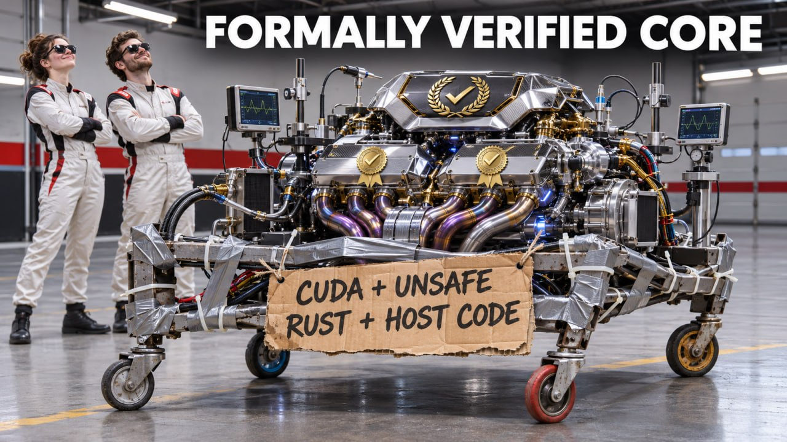

<!-- _class: lead -->

# Toward Formally Verified ZKEVMs

  
Cody Gunton Devcon 8, November 5, 2026  <a href="https://codygunton.github.io/talks-and-writing/2026-11-05-devcon/">https://codygunton.github.io/<wbr>talks-and-writing/2026-11-05-devcon/</a>

  

---

# ZKEVM, with an E

* ZKEVM team focus: proofs of block execution for L1 scaling.
  * We don't build a ZKEVM (leanVM is not a ZKEVM).
  * We standardize, test and otherwise steward a collaboration with external teams.
* I won't speak much of other applications of ZK or FV.

---

# Takeaways first

* We will have ZKEVMs with significant formal guarantees attached.
* AI does not make this easy or guarantee that end-to-end fv is practical.
* The community has learned a lot, but we still do not have a clear path to make ZKEVMs that are simultaneously:
  * High performance (real-time proving on a small number of GPUs);
  * High assurance (high degree of coverage by formal verification);
  * Maintainable (the formal proofs are robust invariant in CI).

---

# Prerequisites

I will assume you are familiar with ZKEVM terminology and basics of how these will be used to scale L1. Reference: [EPF Study Group #3: zkEVMs](https://www.youtube.com/watch?v=Z0Nad1wB_pY).

  

  

---

<!-- _class: lead -->
<!-- _paginate: false -->

# ZKVMs (RISC-V ones)

  
<a href="https://codygunton.github.io/talks-and-writing/2026-11-05-devcon/">https://codygunton.github.io/<wbr>talks-and-writing/2026-11-05-devcon/</a>

  

---

# Specifications for executables in ZKVMs

The RISC-V community maintains a formal specification, its [Sail model](https://github.com/riscv/sail-riscv).

- [Sail](https://github.com/rems-project/sail) has backends to Lean, Rocq, C, SystemVerilog, and several other languages, so we can test the spec and also verify against it.

* # The Dream Statement

  For any program compiled to RISC-V for execution in the ZKVM, and for any valid inputs to the program, a verifier will accept a proof of execution for that program if and only if the prover supplied the [RISC-V spec](https://github.com/riscv/sail-riscv)-compliant execution trace of that program.

  - Completeness: the "if" part.
  - Soundness: the "only if" part.

<!-- --- -->
<!---->
<!-- # Specifications for ZKVM executables -->
<!---->
<!-- Other ISAs have open formal specifications too, but they reach Sail by translation rather than being written in it. -->
<!---->
<!-- - Arm: Arm publishes its spec in its own language, [ASL](https://developer.arm.com/downloads/-/exploration-tools). [sail-arm](https://github.com/rems-project/sail-arm) is generated from it and builds to Lean and Rocq. -->
<!-- - x86: no vendor spec. [sail-x86-from-acl2](https://github.com/rems-project/sail-x86-from-acl2) is generated from the academic [ACL2 x86isa model](https://github.com/acl2/acl2/tree/master/books/projects/x86isa). -->

---

# Progress: Soundness of RISC-V circuits

We have proofs of the form: "if a ZKVM's circuits accept a machine step, then the machine step was valid according to the RISC-V spec".

- Examples: [sp1-lean](https://github.com/succinctlabs/sp1-lean), [openvm-fv](https://github.com/openvm-org/openvm-fv), [pico-fv](https://github.com/NethermindEth/pico-fv), [zisk-fv](https://github.com/eth-act/zisk-fv).
- Formal verification catches serious bugs.

* # Gap: Maintenance and Testing

  We need reproducible Lean extractions and testing.

---

# Gap: Soundness of accelerator circuits

No ZKVM has viable performance without dedicated circuits for certain heavy computations (modular arithmetic and Keccak, in particular).

- [openvm-fv](https://github.com/openvm-org/openvm-fv) has coverage of some hashing precompiles.
- Otherwise this is a large gap.

* # Gap: Standards compliance

  ZKVMs must also follow the [zkevm-standards](https://github.com/eth-act/zkevm-standards/) that go beyond the ISA: accelerator interface, accelerated memory operations, I/O and termination semantics.

  - Today compliance with these is only tested ([zkevm-test-monitor](https://github.com/eth-act/zkevm-test-monitor/)).
  - Tests catch a lot, but they are not proofs. Closing this gap is future work.

---

# Gap: RISC-V Circuit Completeness

Recall this means: every RISC-V step is provable by the ZKVM.

- Without this, you can have an unprovable transaction that can DoS the network.
- This is distinct from the completeness statements proven in the [clean](https://github.com/Verified-zkEVM/clean) DSL, that the witness generator produces values that satisfy the constraints.

* # Gap: Prover Liveness in General

  Just like with verifiers, non-circuit bugs, even really silly ones, can crash the network.

  - We have no framework for proving safety of CUDA code.
  - Unsafe Rust abounds, and unsafe code is disproportionately buggy because it is where the complexity concentrates. Much to do to formalize this.

---

<!-- _paginate: false -->

---

# Progress: Security of Cryptographic Protocols

How do we know the cryptography is secure, conditional on standard assumptions?

* [Verified-zkEVM/ArkLib](https://github.com/Verified-zkEVM/ArkLib) and friends give a framework for making specs and producing security proofs. Much progress there!
* This is the soundness of the composite cryptographic protocol.
* Sidenote: [soundcalc reports](https://github.com/ethereum/soundcalc/tree/main/reports) have partial automation of this work, and they show that most ZKVMs have far too few bits of security, often fewer than they target.

---

<!-- _paginate: false -->

---

# Gap: Recursion Circuits

All ZKVMs use recursive verification to collect proofs generated in parallel and compress them to a final smallish proof.

* The intermediate steps typically use different circuits and possibly even different proving STARKs (exception: [Airbender](https://github.com/matter-labs/zksync-airbender)).
* The "spec" is no longer the RISC-V spec, but rather a spec for an intermediate STARK verifier. No canonical spec, hence less assurance ([ArkLib](https://github.com/Verified-zkEVM/ArkLib) can help).
* Theory caveat: recursion runs Fiat-Shamir inside a circuit, and our security arguments are limited by our ability to reason about Fiat-Shamir in circuits.

---

# Gap: Protocol Implementation

How do we know the cryptography is strong, and how do we know that the implementation follows the spec?

- For the signature aggregation in the CL via leanVM, we can link safe Rust to [ArkLib](https://github.com/Verified-zkEVM/ArkLib) specs (e.g., using [Aeneas](https://github.com/AeneasVerif/aeneas)).
- For ZKEVMs, the implementations are largely written in CUDA, and the community has made no progress on verifying them.

---

# Gap: The SNARK Verifier

No team has a formally verified verifier implementation.

* The verifier is more than just the circuits.
  - How do we know it uses the whole proof?
  - How do we know it doesn't just skip some AIR expression?
  - How do we know that there is not a Fiat-Shamir bug?
* We don't want to FV the mathy stuff and get owned by something 'easy'.
* A spec is, again, a cryptographic protocol spec.

---

<!-- _paginate: false -->

---

<!-- _class: lead -->
<!-- _paginate: false -->

# Guest Programs

  
<a href="https://codygunton.github.io/talks-and-writing/2026-11-05-devcon/">https://codygunton.github.io/<wbr>talks-and-writing/2026-11-05-devcon/</a>

  

---

# Specifications for guest programs

The canonical guest spec is Python: [stateless_guest.py](https://github.com/ethereum/execution-specs/blob/3ebcb5d02126918eb2aad599b3cf286200d4f458/src/ethereum/forks/amsterdam/stateless_guest.py).

* The python spec is not suitable for formal proving.
* Existing Formal EVM specs: [KEVM](https://github.com/runtimeverification/evm-semantics), [Verifereum](https://github.com/verifereum/verifereum), [EVMYulLean](https://github.com/NethermindEth/EVMYulLean), [evm-dafny](https://github.com/Consensys-Incorporated/evm-dafny).
Coverage varies (evm-dafny targets Berlin, Verifereum targets Osaka), and none specifies the stateless guest (witness, SSZ input).

* [evm-sail](https://github.com/frisitano/evm-sail): an experimental EVM spec in Sail, the same language as the RISC-V spec from earlier, which also covers stateless validation.

* Alex Hicks's WIP [leanerSTFSpec](https://github.com/alexanderlhicks/leanerSTFSpec), pure Lean, aiming to be executable.

---

# Progress: evm-asm Experiments

As Derek Sorensen explained an hour ago, there is progress on using Lean to write a guest program ([evm-asm](https://github.com/Verified-zkEVM/evm-asm)) directly in assembly and prove compliance statements about it.

- Proving full compliance is out of reach.
- Successor project using [pancake](https://github.com/CakeML/cakeml/tree/master/pancake) seeks to simplify the compliance proofs by removing the execution of assembly. There is no compliance proof; [evm.fast](https://www.yukon.org/evm.fast) proves improvements relative to a fixed implementation.

* # Gap: Performance of verifiable code

  - We have seen that the raw assembly LLMs write has bad performance by default.
  - Verify then optimize might be viable, but the cost profile is unknown.
  - Writing directly in Lean requires that you either run the interpreter (maybe viable for CPU proving) or compile to a guest (maybe trusting Lean-to-C is OK).

---

# Gap: Source code in low-level languages

For performance, teams generally use systems programming languages such as Rust, C++ or Zig. Nethermind uses C# with runtime modifications.

- Outside of safe Rust, we can have basic runtime safety concerns.
- There are concerns about bump allocators and the possibility of running out of memory in the ZKVMs, which have different memory models.
- We need trusted extraction from source code into an FV framework.

---

# Gap: Compiler Bugs and Runtime Safety

Another approach: formally verified compilers and only languages with runtime safety guarantees.

* There is a certified C compiler, [CompCert](https://github.com/AbsInt/CompCert), but it's not FOSS.
* There is a certified compiler for a language called [Pancake](https://github.com/CakeML/cakeml/tree/master/pancake).
  * Low level, potentially good performance, but there's no runtime safety.
  * [stateless-pancaketh](https://github.com/flamingoponderado/stateless-pancaketh) is a guest, the successor to [evm-asm](https://github.com/Verified-zkEVM/evm-asm).

---

# Gap: Compiler Bugs and Runtime Safety (cont'd)

* Verified rustc? Rust uses LLVM, a big, complicated compiler toolchain.
  * There is a long-term project [VeIR](https://github.com/opencompl/veir) to make a universal verified compiler toolkit.
* Verified [cranelift](https://github.com/bytecodealliance/wasmtime/tree/main/cranelift)?
  * A much simpler compiler for rust, with a ~15% performance penalty.
  * AI experiment: get a baseline verified Rust compiler ASAP: [clifv](https://github.com/eth-act/clifv).
  * A Lean implementation, with 41% of test objects (on ARM) compiling to the same bytecode as stock Cranelift.
  * Three compiler bugs reported.
  * No bare-metal RISC-V support... yet 😈

---

<!-- _paginate: false -->

---

# Gap: Compiler Bugs and Runtime Safety (cont'd)

We can't expect everyone to write everything in [Pancake](https://github.com/CakeML/cakeml/tree/master/pancake) or safe Rust.

* Formal verification of the binary is plausible but has not been shown to scale:
  * Naive cost for runtime safety: 800 Lean lines per RISC-V instruction.
  * Theorem + Anthropic: safety in a few dozen lines of Rocq per RISC-V instruction.
  * My own experiment on [zesu](https://github.com/Consensys-Incorporated/zesu): same ballpark as what Theorem + Anthropic report.
* [leanVM](https://github.com/leanEthereum/leanVM)'s aggregation guest has an advanced-stage binary verification under assessment. It seems read-only memory is a big simplification.
* Not enough data on compliance proof sizes or token efficiency.
* **No data on the maintenance story in general.**

---

<!-- _class: lead -->
<!-- _paginate: false -->

# Conclusion

  
<a href="https://codygunton.github.io/talks-and-writing/2026-11-05-devcon/">https://codygunton.github.io/<wbr>talks-and-writing/2026-11-05-devcon/</a>

  

---

# In Summary

* Under Control
  - RISC-V and accelerator compliance.
  - Cryptographic protocol correctness.

* Seems Pretty Doable
  - Recursive circuit compliance.
  - Final verifier compliance.

* Needs a Convincing Story
  - Guest compliance.
  - Standards compliance.
  - Prover runtime safety.
  - CI / maintainability of everything.

---

# Build with me 🙏

- [zisk-fv](https://github.com/eth-act/zisk-fv): formal verification of ZisK's RISC-V circuits.
- [clifv](https://github.com/eth-act/clifv): experiment toward a verified Cranelift, in Lean.
- [zkevm-standards](https://github.com/eth-act/zkevm-standards/): the standards zkVMs must follow beyond the ISA.
- [zkevm-test-monitor](https://github.com/eth-act/zkevm-test-monitor/): compliance testing across zkVMs.
- [L1-zkEVM breakout calls](https://github.com/ethereum/pm/issues/2269): monthly public call, next one in December.

* 

    <h1 style="margin:0;">Thanks!</h1>
    
  

