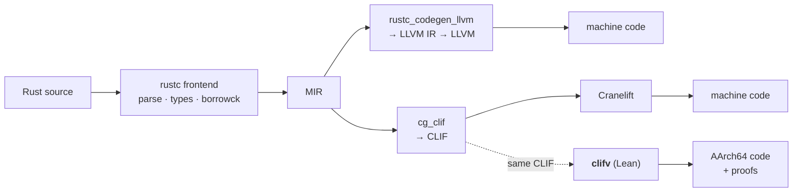
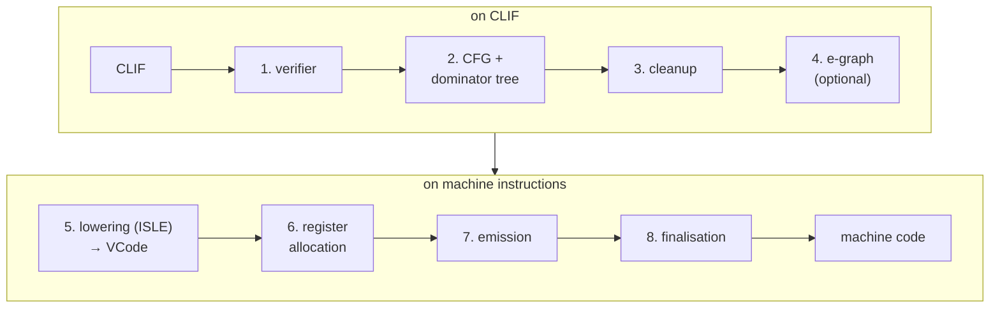
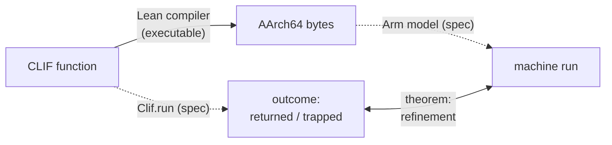
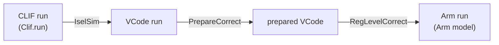

## In one paragraph

clifv is a compiler, written in Lean 4, that turns Cranelift's intermediate representation (CLIF) into AArch64 machine code. It comes with machine-checked proofs that the generated code behaves as the source program does. It is built to reproduce what stock Cranelift emits, byte for byte. On Cranelift's own test suite, **1,996 of 4,455** function outputs are already byte-identical to stock Cranelift. **1,713** of those come out of the proved compiler with no unproved step. Most of the remaining gap is SIMD, which clifv does not support yet. The proofs rest on two specifications written in Lean: a semantics for CLIF and a model of the Arm processor. Both are tested against independent references rather than proved. The proof library is large, about 1.1 million lines of Lean, which is roughly six times the size of the Cranelift code it mirrors. Building it is the main engineering bottleneck.

## 1. How Rust becomes machine code

A compiler is usually described in two halves. The **frontend** understands the language: it parses, resolves names, checks types and, for Rust, checks borrowing. The **code generator** (or *backend*) takes a low-level, language-independent description of the program and turns it into instructions for a particular processor. That work consists of choosing instructions, assigning values to registers, laying out stack frames, and encoding the result as bytes.

The Rust compiler, `rustc`, does its language-specific work on its own mid-level IR (MIR). It then hands MIR to a pluggable code generator. The default one is **LLVM**: plain LLVM through `rustc_codegen_llvm`, using Rust's own fork of LLVM (LLVM 22 in current nightlies). MLIR plays no part. Two alternative backends exist: `rustc_codegen_gcc`, and `rustc_codegen_cranelift` ("cg_clif"), which translates MIR into Cranelift's IR.



**Cranelift** is a code generator written in Rust. It began at Mozilla in 2016, under the name Cretonne, to compile WebAssembly in Firefox. It now lives in the Bytecode Alliance alongside **Wasmtime**, a standalone WebAssembly runtime. Its design follows from what a WebAssembly runtime needs:

- **Compile time matters.** A runtime receives code when a module is loaded and must compile it right away, often just in time.
- **A miscompilation is a security hole.** The runtime executes untrusted code inside a sandbox, so a wrong bounds check is a sandbox escape.
- **The compiler must be small and memory-safe.** It runs inside the runtime's own process.

LLVM optimises much harder, but it is too slow and too large for that job. Cranelift therefore trades some code quality for compile speed and simplicity: a 2020 study measured an order of magnitude faster compilation for code roughly half as fast. Today it is the default compiler of Wasmtime, an optional backend of the Wasmer runtime, and, since October 2023, an optional `rustc` backend on nightly for faster debug builds. Firefox tried it and later dropped it.

Within the Rust stack, Cranelift replaces LLVM's whole pipeline: the IR, the optimizer and the code generator. The **frontend** that feeds it, cg_clif, is a real compiler stage of about 19 k lines, not a mere parser. By the time it runs, `rustc` has already done parsing, type and borrow checking, trait resolution, monomorphisation and MIR optimisation, including inlining. cg_clif then translates each monomorphised function into CLIF:

- it breaks structs and enums into scalars and memory accesses, following `rustc`'s type layouts;
- it implements Rust's calling convention on top of CLIF signatures;
- it expands intrinsics: atomics, and SIMD lane by lane through memory;
- it emits panic paths and the landing pads for unwinding.

It optimises little, but it makes many binding decisions about layout and the ABI. clifv trusts it.

clifv replaces the last stage again. It takes the CLIF that cg_clif produces and generates the AArch64 code that Cranelift would have generated, with a proof attached. `cargo fv build|test` runs the whole chain on real crates. A function clifv cannot handle keeps cg_clif's code, so a build never fails because of clifv.

## 2. CLIF and how Cranelift compiles it

### CLIF in one minute

**CLIF** (Cranelift IR) plays the same role for Cranelift that LLVM IR plays for LLVM. Both are low-level and independent of the target. Each describes one function as a list of **basic blocks**: straight-line instruction sequences that end in a jump, branch or return. Both are in **SSA form**: every value is defined exactly once and has a type. CLIF is the simpler of the two:

- **Machine types only:** `i8`…`i128`, `f32`, `f64` and vectors. There are no pointer types (a pointer is an integer) and no structs; the frontend has already broken those down.
- **Block parameters instead of φ-nodes.** Where control flow merges, LLVM uses φ-instructions; CLIF passes values to a block the way a call passes arguments (`block2(v5: i64)` below).
- **Explicit trap behaviour.** Memory accesses carry flags such as `notrap` and `aligned`, and an operation like division names its trap.

```
function %clamp_add(i64, i64) -> i64 {
block0(v0: i64, v1: i64):
    v2 = iadd v0, v1
    v3 = iconst.i64 100
    v4 = icmp sgt v2, v3
    brif v4, block1, block2(v2)
block1:
    jump block2(v3)
block2(v5: i64):
    return v5
}
```

Two traits of Cranelift are often singled out. Neither is unusual:

- **Typed SSA** is the norm (LLVM, GCC's GIMPLE, MLIR). What sets CLIF apart is how low-level its types are.
- **Compiling one function at a time** is how code generators work, LLVM's included. LLVM's cross-function optimisations (inlining, interprocedural analysis) happen earlier, in its optimizer over a whole module. Cranelift has no such module-level stage, and it only ever sees one function. That lets it compile functions in parallel, lazily in a JIT, and cache them individually. Cross-function optimisation is left to its user. Inlining is still possible: Cranelift offers it "as a library", where the user decides which calls to inline and supplies the callee's body. cg_clif relies on `rustc`'s own MIR inliner instead.

### The pipeline, stage by stage



1. **Verifier.** It checks that the CLIF is well formed: types match, every value is defined before every use, and every block ends in a terminator. "Verifying CLIF" means this check, not formal verification.
2. **Control-flow graph (CFG) and dominator tree.** CLIF already lists its blocks and branches, so building the CFG is cheap: one scan of the terminators records each block's successors and predecessors. Block A **dominates** block B if every path from the function's entry to B passes through A. The immediate dominators form a tree. Later passes use it to find loops, decide where code may safely move, and check that every definition precedes its uses.
3. **Cleanup.** Blocks unreachable from the entry are deleted. Then **constant phis** are removed: a block parameter that receives the same value on every incoming edge is replaced by that value. In the example, if `block1` also jumped with `v2`, then `v5` would always be `v2` and could disappear, saving a move.
4. **Mid-end optimisation (optional).** An e-graph applies a few hundred rewrite rules at once, then extracts a cheap equivalent. Cranelift skips this stage at `opt_level=none`, the setting of the test outputs compared in section 7.
5. **Lowering (instruction selection).** CLIF becomes **VCode**: real instructions of the target (`add`, `ldr`, `cbz`…) over an unlimited supply of *virtual* registers, still arranged in blocks. Think of assembly with infinitely many registers. The choice of instructions is made by ISLE rules. A rule can fuse several CLIF instructions into one machine instruction; for example, a shift feeding an add becomes one `add` with a shifted operand.
6. **Register allocation** (the `regalloc2` library). Virtual registers are mapped onto the 31 real ones, inserting moves and spills to the stack where they run out. This has to come after lowering: the allocator needs the actual instructions, with their constraints (which operands must sit in fixed registers, what a call clobbers). LLVM and GCC use the same order.
7. **Emission.** Only now are the register assignments and spill slots known, so only now can the frame be laid out: its size, and which callee-saved registers the prologue must save. Each instruction is encoded into a buffer, with branch targets still symbolic labels.
8. **Finalisation.** Once every instruction's size is known, the labels become concrete offsets. Branches are simplified: a jump to the next block is dropped and a branch over a jump is inverted. Branches that cannot reach their target get a long-range form, and constant pools and relocations are written. The steps are split this way because each one needs information that only the previous step produces.

Older descriptions of Cranelift, from before its 2020 backend rewrite, include a **legalisation** stage. It was not an error check. It repeatedly replaced each CLIF instruction the target had no instruction for by a sequence of simpler CLIF instructions, until every instruction mapped one-to-one onto a machine instruction. The ISLE lowering rules replaced it, because a rule can also map *several* CLIF instructions onto *one* machine instruction. clifv's own `i128` legalisation is a CLIF-to-CLIF pass in that older sense.

### ISLE: rules as data

Most of stages 4 and 5 is written not in Rust but in **ISLE**, a small pattern-matching language for rewrite rules. For example, an AArch64 rule says, roughly, "an `iadd` whose operand is a small constant becomes an `add` with an immediate". Because the rules are data, a tool can export them mechanically. clifv runs Cranelift's 1,165 AArch64 lowering rules in Lean, exported from the ISLE sources, and that is a large part of why verifying Cranelift is tractable at all.

## 3. Why Cranelift is so much smaller than LLVM

Measured with `tokei` on the versions in use: Cranelift 0.136.1 (Wasmtime 49.0.1) and LLVM 22.1.8. The counts are code lines, so comments and blank lines are excluded. Test suites are excluded, and so is Cranelift's in-tree verification tooling (VeriISLE, section 4).

| | Cranelift | LLVM | Ratio |
|---|---:|---:|---:|
| Whole code generator | **186 k** (157 k Rust + 29 k ISLE) | **2.88 M** (2.38 M C/C++ + 0.50 M TableGen), `llvm/lib` + `llvm/include` | ≈ 15× |
| Everything needed for AArch64 | 72 k (shared code + AArch64 backend + ISLE) | 921 k (IR, analyses, optimizer, CodeGen, MC, AArch64 target) | ≈ 13× |
| Without the mid-level optimizer | 72 k | 498 k (CodeGen, MC, AArch64 target) | ≈ 7× |
| `rustc` glue crate | 19 k (`rustc_codegen_cranelift`) | 25 k (`rustc_codegen_llvm`) | ≈ 1× |
| *For scale:* clifv's Lean library | 1.09 M | | |

The remembered figure of "300 k versus 1.5 M" understates the gap: the full LLVM library is nearly 3 M lines of code. The difference comes from scope:

- **Targets.** Cranelift has four (x86-64, AArch64, RISC-V 64, s390x) plus Pulley, its own interpreter bytecode. LLVM ships 25.
- **Optimisation.** LLVM's optimizer alone (`lib/Transforms` and `lib/Analysis`, 363 k lines) is larger than all of Cranelift. Cranelift's mid-end is a few thousand lines of rules on one e-graph, with no auto-vectoriser, little inlining and no link-time or profile-guided optimisation.
- **One path.** CLIF goes straight to machine instructions through ISLE rules. LLVM has two instruction selectors (SelectionDAG and GlobalISel), several register allocators, and a machine-IR layer between them.
- **A DSL for the target-specific part.** The AArch64 lowering is about 6 k lines of ISLE. LLVM's AArch64 target is 115 k lines of C++ plus 75 k lines of TableGen.

## 4. What it means to verify a Cranelift backend

### What exists upstream

Cranelift has no official formal specification. In practice its semantics is defined by three things: its documentation, an executable **reference interpreter** (the `cranelift-interpreter` crate), and about 1,300 test files. Its correctness rests mainly on heavy fuzzing. Several verification efforts have been added over time:

| When | What | What it covers |
|---|---|---|
| from 2021 | **regalloc2 checker** | Checks each register allocation symbolically while fuzzing. Optional in production. |
| 2023 | **Proof-carrying code** | Checks, after lowering, that compiled WebAssembly memory accesses stay inside the sandbox. Experimental; no longer in the tree as of Cranelift 0.136. |
| 2024 | **Crocus / VeriISLE** (ASPLOS 2024) | Verifies individual ISLE lowering rules with SMT solvers against hand-written specifications of CLIF and of AArch64 and x86-64 instructions. Reproduced known sandbox-escape bugs. |
| 2025 | **Arrival** (OOPSLA 2025) | Derives AArch64 specifications automatically from Arm's official ASL semantics. Verifies nearly all AArch64 rules reachable from WebAssembly and finds new bugs. Its specifications have shipped in the Cranelift tree since Wasmtime 47. |

These efforts check **rules one at a time**, not the compiled program end to end. They also need upkeep. In April 2026 a critical AArch64 lowering bug, introduced in Wasmtime 32, was found by LLM-based auditing rather than by the verifier, because the verification model had not been updated for the new rules. Re-run on the current rules, the verifier flags the bug too. Wasmtime has since committed to running it in CI.

### clifv's approach

clifv is a **reimplementation, not a proof about the Rust code**. The compiler is a Lean program, so the code the theorems talk about is the code that runs: there is no extraction or translation step. It follows Cranelift's algorithms closely, and its instruction selection executes Cranelift's own exported ISLE rules. Byte-for-byte agreement with stock Cranelift is then evidence that it makes the same choices. Correctness is stated against two specifications that are themselves written in Lean:

| Specification | What it is | How it is checked (not proved) |
|---|---|---|
| **`Clif.run`**: the semantics of CLIF | An executable interpreter: a function, its arguments and fuel go in; the outcome *returned values and memory*, *trapped with code c*, *stuck* (undefined behaviour) or *out of fuel* comes out. About 7.7 k lines in `FV/Clif`. | Random programs for every supported opcode are compared bit-exactly against Cranelift's interpreter and native AArch64 runs (394 opcode keys, 0 disagreements). Each opcode is also proved equal to a Lean transcription of VeriISLE's CLIF specification. |
| **The Arm model** | AArch64 instruction semantics ported from LNSym, which transcribes Arm's ASL. About 15 k lines in `FV/Arm`. | Every instruction form the encoder can produce is co-simulated against `qemu` (424 forms, 0 failures), nightly in CI. |



### Why not verify Cranelift's Rust code directly?

A tool such as **Aeneas** translates Rust into Lean, after which one could prove theorems about Cranelift itself. The project's records give no reason for not doing this; its plan mentions Aeneas only for an unrelated, unstarted route. Two reasons are likely [our inference]:

- **Aeneas does not yet support the Rust that Cranelift is written in.** It handles safe Rust without closures or function pointers, nested loops, interior mutability or nested borrows in signatures. A 186 k-line compiler built on mutable arenas and index-based data structures uses all of these.
- **A reimplementation can be designed for proof.** The difficult heuristics, such as register allocation, can stay unproved behind a proved checker with a proved fallback. A proof about the Rust code would have to cover them as written.

The cost of reimplementing is that clifv must be kept in step with upstream Cranelift. That is what the byte-for-byte comparison measures.

### Why this is feasible at all

- The thing being verified is about 15× smaller than LLVM.
- The target-specific knowledge is data (ISLE rules) and can be imported and reasoned about uniformly.
- Both ends have independent oracles: Cranelift's interpreter for CLIF, and Arm's ASL plus `qemu` for the machine.
- Heuristics need not be proved: a register allocator's output can be checked by a proved checker (section 5).
- Lean is both the programming language and the prover.

## 5. The compiler's components and how each is assured

clifv uses four kinds of assurance. The difference matters, because "verified" means something slightly different for each:

- **Proved:** the pass itself is proved correct, once and for all.
- **Proved checker:** an untrusted pass (possibly external code) runs, then a proved checker validates its result for this function (*translation validation*). Further theorems show that the checker never rejects what the pass produces on in-scope input.
- **Proved fallback:** if a check fails, the compiler uses a simpler path that is proved directly. A rejection costs code quality, never correctness.
- **Trusted:** taken on faith and tested.

| Stage | What it does | Assurance |
|---|---|---|
| rustc + cg_clif | Rust → CLIF | **Trusted** (outside the scope by design) |
| Dump decoding and linking spec | cg_clif's output files → Lean program | Proved |
| `i128` legalisation | Splits 128-bit values into pairs of 64-bit values | Proved checker (complete on a decidable input condition) |
| Mid-end optimiser (`--opt` only) | e-graph-style rewrites, GVN, DCE, LICM | Rewrite rules proved one by one (two wrong upstream rules disabled); passes checked, with a proved fallback |
| Constant-phi removal | Cranelift's `remove_constant_phis` | Proved checker, with a proved fallback |
| Instruction selection | Runs Cranelift's ISLE rules | Proved, once for all rules |
| Lowering driver, `prepare` | Builds the VCode; splits critical edges; orders blocks | Proved checkers, proved complete on decidable input conditions |
| Register allocation | Lean linear scan, or regalloc2 | Proved checker (`checkAlloc`), with a proved spill-everything fallback |
| Frame, emission, encoding | Prologue and epilogue, branch relaxation, bytes | Proved (`decode (encode i) = i`) |
| Linking the executable | Placement, relocations, ELF | Proved (`Link.compileExe`), with no per-program certificate |
| Unwind tables | `.eh_frame`, LSDA for exceptions | Mostly proved; the unwinder model is trusted |

## 6. The theorems

### How they are organised

The proof is layered. Each layer relates the run of one representation to the run of the next, and the layers compose:



The composite theorem for one function is `E2E.backend_correct_final` (`FV/E2E/Final.lean`). Further theorems extend it outward:

- a whole linked program (`E2E.backend_correct_linked`);
- the bytes of the executable file (`Link.DeadCleanup.compileExe_correct`);
- the program exactly as cg_clif wrote it to disk (`Front.bundle_correct_raw`).

Every function that `cargo fv` reports *verified* is covered by one of them.

### What "correct" means

The conclusion is a **refinement**: whatever the CLIF semantics says the function does, the Arm code does too. Verbatim from `FV/E2E/Statement.lean`:

```lean
/-- What the Arm run does for a CLIF outcome (`stuck`/`outOfFuel`: no claim). -/
def ArmRefines (fb : FnBin) (base ra : BitVec 64) (astep : Arm.ArmState → Arm.ArmState)
    (s : Arm.ArmState) : Clif.Outcome → Prop
  | .returned vals cm => ∃ n, ArmRet ra s (runX astep n s) ∧
      (∀ (j : Nat) v, vals[j]? = some v → XHolds v (xreg j (runX astep n s))) ∧
      MemAgree cm (runX astep n s)
  | .trapped c => ∃ n, TrapAt fb base c (runX astep n s)
  | .stuck _ | .outOfFuel => True
```

In words:

- **If the CLIF function returns** values `vals` with final memory `cm`, then after some number of steps the machine is back at the caller's return address. The results are in `x0, x1, …`, the stack pointer and callee-saved registers are restored, and memory agrees with `cm`.
- **If it traps** with code `c`, the machine stops at a trap site with code `c`.
- **If the CLIF run is stuck** (undefined behaviour) **or runs out of fuel**, nothing is claimed.

This is the shape of CompCert's semantic preservation, restricted to terminating and trapping runs. There are no I/O traces, and nothing is claimed for non-terminating runs.

### Soundness and completeness

- **Soundness** in the usual sense is the refinement theorem above.
- **Completeness** here means **totality**: the compiler and its checkers accept every function in the declared input scope. Examples are `prepCheck_complete`, `lowerCheck_complete`, `optimize_complete` and `compileExe_total_*`. So a checker can never turn a correct compilation into a rejection.
- **Byte-for-byte agreement with stock Cranelift** is measured, not proved (section 7).

### ABI conformance

An **instruction set architecture (ISA)** is what the hardware provides: registers, instructions and their encodings. An **application binary interface (ABI)** is the set of software conventions layered on top, so that separately compiled code can call each other and link. For 64-bit Arm on Linux, the ABI is **AAPCS64** together with the ELF and system conventions. The table lists what an ABI fixes and how much of it clifv's theorem states:

| The ABI fixes… | On AArch64 Linux | In clifv's theorem? |
|---|---|---|
| Where arguments go | Integers in `x0`–`x7` and floats in `v0`–`v7`, the rest on the stack | **Stated** |
| Where results go | `x0…` (and `v0…`); a large result is written through a pointer passed in `x8` | **Stated** |
| Which registers a callee must preserve | `x19`–`x28`, the frame pointer `x29`, the low halves of `v8`–`v15`; all others may be overwritten | **Stated** |
| The return address and the stack | Return address in `x30`; the stack grows down, `sp` 16-byte aligned at every call and restored on return | **Stated** |
| Frame layout | Frame-pointer chain (`x29`/`x30` pair), frame records | Follows Cranelift, not stated |
| Reserved registers | `x18` platform register, `x16`/`x17` scratch for linker veneers, `TPIDR_EL0` for thread-local storage | Thread-local storage by a trusted hook |
| Data layout | Sizes and alignment of types, little-endian, struct layout | Little-endian in both semantics; struct layout is `rustc`'s (trusted) |
| Exceptions and unwinding | DWARF call-frame information and LSDA tables | Tables proved; the unwinder model trusted |
| Object files and linking | ELF, `R_AARCH64_*` relocations, symbols, thread-local-storage models | Linking proved (`compileExe`) |
| System calls | Linux syscall numbers and registers | Outside: in musl, trusted |

The rows marked **Stated** are part of the theorem's statement. They are a trusted transcription of AAPCS64 *as Cranelift implements it*, not proved against an independent formalisation of AAPCS64. Only AArch64 is covered; clifv has no RISC-V or x86 backend.

### What the theorems assume

The premises of `backend_correct_final` fall into four groups:

1. **The compiler ran and accepted the function.** These conditions are decided by code, per function.
2. **The machine is entered correctly.** Code is loaded, the program counter is at the entry, the stack is aligned and big enough, and arguments are placed per AAPCS64.
3. **Callees and the environment keep their contracts.** A called function behaves as its CLIF declaration says and preserves callee-saved state. Thread-local storage and the linker's symbol addresses are as stated.
4. **The run only traps explicitly.** Traps come from `trap` instructions and divisions, never from memory faults, because the Arm model has no memory faults.

Beyond the premises, the **trusted base** is:

- Lean's kernel;
- `Clif.run` and the Arm model;
- the statement itself, including its AAPCS64 transcription;
- rustc and cg_clif;
- code outside the program (std, musl, functions left to cg_clif) and the OS loader;
- the unwinder model.

Two hygiene measures keep the statements honest:

- Every top-level theorem has a **non-vacuity witness**: a concrete instance where all premises hold. These witnesses have caught six unsatisfiable premises so far.
- An **axiom audit** (261 files) checks that only Lean's three standard axioms are used. There is no `sorry` and no custom axiom. The compiler theorems use no `native_decide`.

### Optimisation passes

The semantics that optimisations must preserve is again `Clif.run`. The mid-end's theorem (`Opt.optimize_sim_proven`) is a simulation: every outcome of the optimised function is an outcome of the original. Cranelift's rewrite rules are proved one by one with a kernel-checked bit-vector tactic: 1,191 of 1,193 rule roots. The other two are wrong. For out-of-range shift amounts they build ill-typed IR (`shifts.isle` rules 84 and 88), so clifv disables them. The surrounding passes (GVN, DCE, LICM) are checked, with a proved fallback. Note that the default `cargo fv` mode and Cranelift's tests run at `opt_level=none`, so the byte-agreement numbers below do not exercise the mid-end.

## 7. Status

### Scope

| In scope | Partial | Out of scope |
|---|---|---|
| Integers `i8`–`i64`: arithmetic, memory, control flow, calls (direct, indirect, `try_call`), atomics, thread-local storage, exceptions | `i128` (by legalisation); floats (`f32`/`f64`, in progress); tail calls (self only) | SIMD and vectors; other targets |

### Agreement with stock Cranelift on its own test suite

This is measured in CI on every pull request. The suite is Cranelift's filetests: 4,455 AArch64 function outputs, each compiled under its file's declared settings.

| | Outputs | Meaning |
|---|---:|---|
| **Exact** | 1,996 (44.8%) | Bytes, relocations and trap records identical to stock |
| **Honest** | 1,713 (38.5%) | Exact, and produced by the proved compiler with no unproved step |
| Differ | 7 | Compiled, bytes differ |
| Rejected: unsupported operation | 1,896 | About 1,257 of them are SIMD |
| Rejected: unsupported setting | 556 | For example `opt_level=speed`, `is_pic=false`, `has_lse` |

The two agreement numbers differ for a reason. The comparison first ran through a harness that applied a few unproved transformations. The **honest** metric (added 13 November) counts only outputs that the proved compiler produces with the test's settings as its input. Two days of work moved it from 76 to 1,713, mainly by making the proved compiler itself handle frameless leaf functions.

### Built but not proved

- **The comparison harness's native `i128` lowering:** about 199 exact outputs depend on it.
- Two smaller harness steps: dropping unused loads, and stack-argument addressing.
- **The driver code that decides, per function, which theorem applies.** It is trusted.
- **Optimisation with Cranelift's unproved rule sets** (`--opt`).

The 7 differing outputs need either a large proof refactor (stack-slot layout) or a change to a trusted statement (calls under the `preserve_all` convention), or they are a deliberate difference that avoids a Cranelift bug.

### Work packages

Most of the original plan is done: validator completeness, totality, linking without certificates, the stack bound, all mid-end rules, i128, unwinding, and the trusted-base reductions for TLS, atomics and the Arm and CLIF fidelity checks. Still open are floats (S11), SIMD (S12), tail calls beyond self calls (S8), the standard-library contracts (T3), and stack-read semantics (SEM1). The full table is in `docs/TO-PROVE.md` §8.

## 8. The Lean library

### Size and shape

| Part | Lean files | Lines |
|---|---:|---:|
| `FV/Backend`: instruction selection, allocation, emission, and their proofs | 3,446 | 616 k |
| `FV/E2E`: end-to-end theorems | 1,206 | 312 k |
| `FV/Isle`: ISLE syntax, interpreter, generated rule data | 52 | 86 k |
| `FV/Opt`: mid-end and rule proofs | 252 | 80 k |
| `FV/Concurrency`: atomics memory model | 230 | 71 k |
| `FV/Link`, `FV/Front`: linker, frontend decoding | 214 | 41 k |
| `FV/Arm`, `FV/Clif`: the two specifications | 99 | 23 k |
| `FVTest`, `crate-proofs` | | 74 k |
| **Total** | **5,832** | **1.31 M** (1.09 M code) |

The library holds about 54,000 theorems. Of its lines, 175 k are generated (rule data and kernel-checked tables). A further 325 k belong to the "Stock" families: proofs for individual lowering patterns that the comparison needed. The library is core Lean and `Std` only. Mathlib is kept to an isolated leaf package (the IEEE float bridge), because importing it upstream of the library measurably slowed every module.

### Build infrastructure

A plain `lake build` would run every ready module at once and exhaust memory. Several modules peak above 10 GB, and runaway proofs once reached 58 GB. The project therefore builds through its own tooling:

- `memcap.sh` runs each command in a memory-capped cgroup, so a runaway process dies alone.
- `lake-serial-build.py` schedules modules one by one, each with a cap of 1.2× its recorded peak memory. Light modules are packed side by side; heavy ones go one at a time through a machine-wide queue.
- A shared, content-addressed artifact cache lets worktrees and CI reuse each other's builds. A warm full check takes 1.9 s instead of 27 minutes.
- A sharded CI "Full gate" builds in waves on up to 16 runners and runs the whole gate list in about 2–3 hours.

### Proof automation

- **`kbv`**: a kernel-checked bit-vector decision procedure. It replaced SAT-backed `bv_decide`, so no compiled-evaluation axiom is trusted. It proves the rewrite rules.
- **`opt_norm`, `opt_eval_head`, `opt_match_head`, `kbv_amt`**: evaluation tactics for ISLE rules. They cut individual proofs from over an hour to minutes; the largest measured cut is 6,575 s to 290 s.
- **Symbolic stepping of Arm code** (`sym_n`), from LNSym.
- **Generated data checked by the kernel:** facts about the ISLE rule tables are decided per chunk with `decide +kernel`, from untrusted generators. `@[csimp]` lemmas swap in fast implementations for execution.

### Bottlenecks

| Module family | Modules | Recorded build time |
|---|---:|---:|
| Kernel-checked ISLE tables (`Isel*Tab*`) | 590 | 13.3 h |
| Stock lowering families | 1,677 | 8.9 h |
| Other backend proofs | 629 | 2.9 h |
| Mid-end rule proofs | 137 | 2.9 h |
| End-to-end and everything else | ~1,760 | 1.1 h |
| **Total** (single-module times, 2 threads, 31 Oct) | **4,797** | **29.2 h** |

- **Kernel-checked tables dominate.** The three slowest modules (`IselPrgTab*`) take 35–45 minutes each.
- **The base modules fan out to nearly everything.** Changing `Backend/Isel.lean`, `Clif/Syntax.lean` or the Arm model rebuilds about 4,900 modules: 12–16 hours locally, or several hours in CI.
- **Memory:** peaks of up to 14 GB per module (one module reached 23.6 GB before a fix).
- **The cache does not always hit.** Lean's output is not fully reproducible, so local caches often miss CI's builds.
- **The proofs are about six times the size of the Cranelift code they mirror.** Almost a third of the lines and build time are spent on the Stock families, which a more general proof could replace.

## 9. Where collaboration could help

- **Build performance.** Restructure the kernel-checked tables. Cut the fan-out of the base modules. Make builds reproducible so the shared cache hits.
- **Proof economy.** Replace the per-pattern Stock families with general theorems.
- **The remaining scope:** SIMD (the largest gap in the test suite), floats, and tail calls.
- **The trusted base.** An independent formalisation of AAPCS64 to prove the ABI statement against, and memory faults in the Arm model.

---

*Sources and measurements.*

- Line counts: `tokei` 15 on Wasmtime 49.0.1 (`cranelift/`, excluding test directories and `isle/veri`), LLVM `llvmorg-22.1.8` (`llvm/lib`, `llvm/include`; TableGen counted separately as non-comment lines), and `rust-lang/rust` `compiler/` at `5f4effd`.
- Lean figures: clifv main `d1c9c47e6`.
- Build times: `scripts/lake-module-peaks.tsv`.
- Agreement numbers: the CI stock comparison on pull request #1054 (13–15 November 2026).
- Theorem names and statements: `FV/E2E/Statement.lean`, `FV/E2E/Final.lean`, `docs/TO-PROVE.md`, `docs/ARCHITECTURE.md`.
